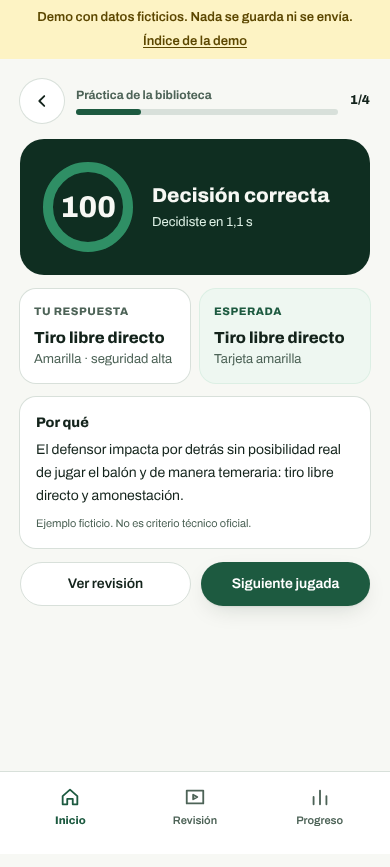
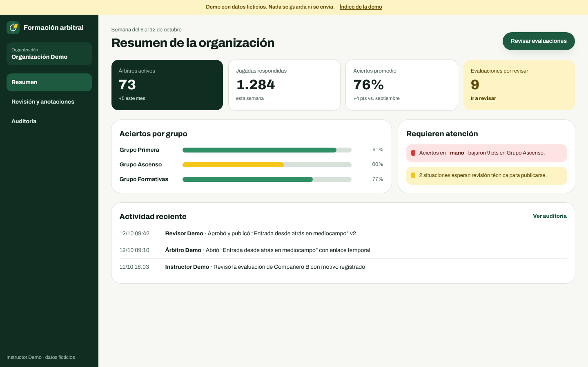
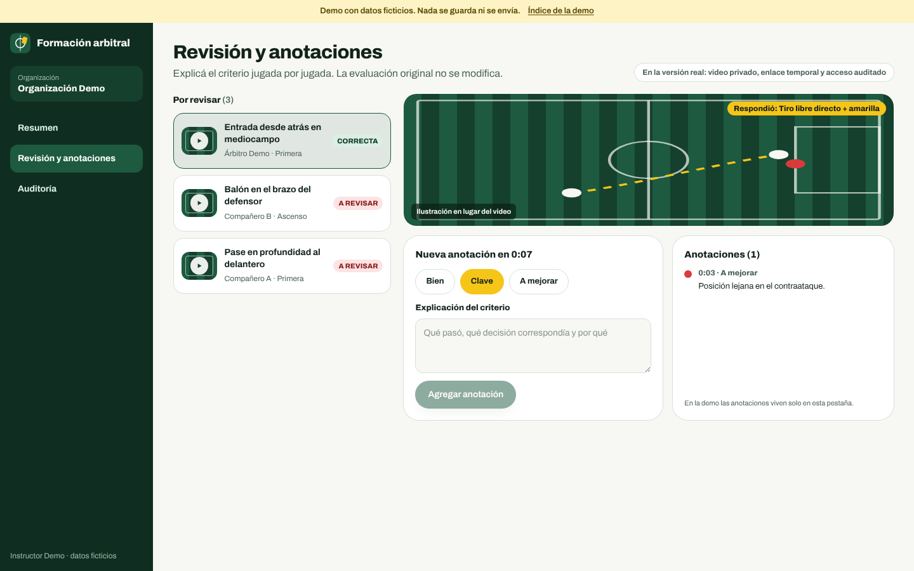

# Identidad visual base (propuesta)
Estado: propuesta en revisión; no forma parte de ninguna entrega aprobada. Cambio MINOR: solo portada y estilos, sin API, datos, permisos ni dependencias nuevas.

## Principios
- Paleta propia inspirada en el campo (verde césped, cal de las líneas) y en las tarjetas del árbitro (amarillo como acento, rojo solo puntual). Sin colores, escudos ni marcas institucionales.
- Toda vista ilustrativa se rotula como tal; no se presentan funciones no implementadas como disponibles.
- Accesibilidad: foco visible amarillo, contraste AA en texto, respeto de `prefers-reduced-motion`, modo oscuro por `prefers-color-scheme`.

## Tokens (apps/web/app/globals.css)
- `pitch-950..50`: escala de verdes para superficies y acento.
- `chalk`, `ink`, `muted`, `line`: fondo, texto, texto secundario y bordes.
- `card-yellow`, `card-red`: acentos.
- Variables semánticas `--surface`, `--surface-raised`, `--text`, `--text-muted`, `--border`, `--accent`, `--focus` cambian en modo oscuro.

## Componentes
- `components/ui/button.tsx`: `Button` y `ButtonLink`, variantes `primary`, `secondary`, `ghost`; tamaños `md` (44 px) y `lg` (52 px), aptos para toque.
- `components/ui/status-pill.tsx`: estados `progress`, `soon`, `neutral`.
- `components/brand-mark.tsx`: marca provisoria.

## Capturas
`after-desktop.png`, `after-mobile.png` y `after-dark.png` (Chromium headless, 1280x800 y 390x844, build de producción local).

## Demo navegable (`/demo`)

Recorrido con datos ficticios para validar la experiencia antes de implementar entregas. No guarda ni envía nada, no usa API ni base de datos y lleva un aviso visible en todas sus pantallas.

- Árbitro: inicio con biblioteca, decisión con confirmación (el criterio queda oculto hasta confirmar), resultado explicado, revisión con anotaciones y progreso.
- Panel: resumen de la organización, revisión con anotaciones del instructor y auditoría filtrable.
- Solo cubre funciones del alcance aprobado del MVP. Entrenamiento físico y combinado, asignaciones, planes, rankings y designaciones quedan en la propuesta CHG-001.

